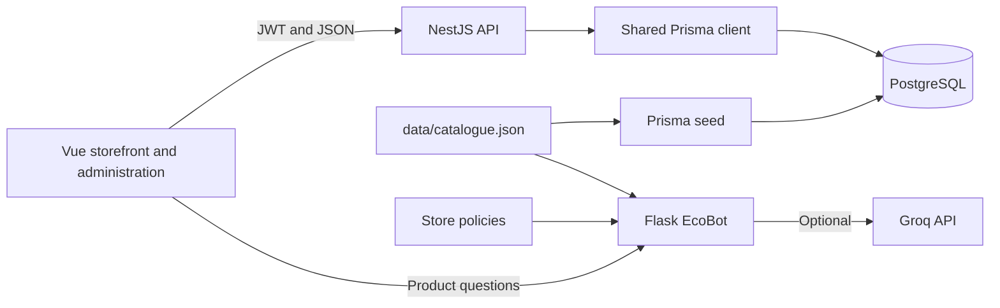
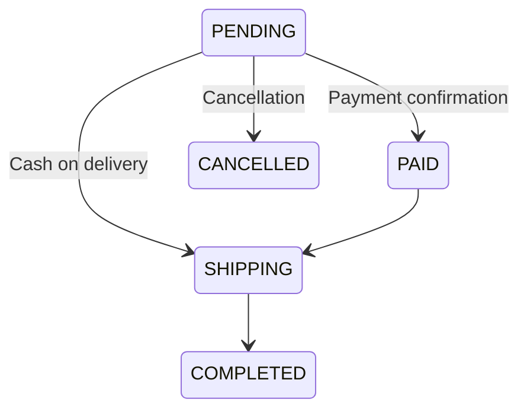

# Architecture

## Services

The Vue application uses shared Axios clients for API requests and bearer tokens. Router guards control navigation; backend guards enforce access permissions.

NestJS feature modules separate HTTP controllers, business services, Prisma repositories, and DTO validation. All modules share one Prisma client and connection pool.

## Authentication

Configuration loads before the JWT module initializes. Token signing and authentication use the same secret. The JWT strategy reads the current account role and active status from PostgreSQL, so account restrictions apply to existing tokens.

Google sign-in is optional. Its callback checks an OAuth state cookie and sends the application token in a URL fragment.

## Checkout and Inventory

1. The request must belong to the authenticated account and include a shipping address and validated order items.
2. Repeated variant IDs are combined before enforcing the limit of 20 units per variant.
3. A database transaction loads product prices, the payment method, and applicable promotions.
4. Stock is decremented only when enough units remain. A failed reservation rolls back the order.
5. Prices and the shipping fee are calculated on the server. Shipping costs 30,000 VND below 500,000 VND and is free at or above that threshold.
6. The order stores the unit price at purchase time. Cancelling a pending order restores reserved inventory once.

Order items are read through their parent order. There is no separate public API for editing an order's unit prices or quantities after checkout.

## Order Status

Completed and cancelled orders cannot be reopened by assigning an arbitrary status.

## Main Endpoints

All NestJS paths below use the `/api/v1` prefix.

| Endpoint                                                  | Access                          | Purpose                            |
| --------------------------------------------------------- | ------------------------------- | ---------------------------------- |
| `GET /product`, `GET /product/:id`                        | Public                          | Catalog search and product details |
| `GET /category`, `GET /product-variant`, `GET /promotion` | Public                          | Storefront data                    |
| `POST /auth/register`, `POST /auth/login`                 | Public                          | Account registration and sign-in   |
| `GET /cart/user/:accountId`                               | Account owner                   | Shopping cart                      |
| `POST /cart`, `PUT /cart/:id`, `DELETE /cart`             | Account owner                   | Cart changes                       |
| `POST /order`                                             | Account owner                   | Create an order and reserve stock  |
| `GET /order/user/:accountId`                              | Account owner                   | Purchase history                   |
| `GET /order/:id`                                          | Owner or administrator          | Order details                      |
| `DELETE /order/:id`                                       | Order owner                     | Cancel a pending order             |
| `POST /order/:id/demo-payment`                            | Order owner; simulation enabled | Simulated payment confirmation     |
| `PUT /order/:id/status`                                   | Administrator                   | Update order status                |
| `GET /order/stats`                                        | Administrator                   | Sales statistics                   |
| `PATCH /comments/:id/visibility`                          | Administrator                   | Review moderation                  |
| `GET /customer_profile/:accountId/profile`                | Owner or administrator          | Customer profile                   |

Swagger is available at `/api/docs`.

## EcoBot

The Flask service exposes `POST /api/chat` and `GET /health`. Chat requests accept a `question` string of up to 1,000 characters, with a 16 KB request body limit.

Catalog retrieval normalizes Vietnamese text and ranks matching keywords. It does not require an embedding model or vector database. Groq can generate a response from retrieved content; failures fall back to catalog answers.

Catalog prices are reference prices rather than live stock or promotion quotations. Private order lookups are not supported.

## Database Migrations

The original migration is preserved. A subsequent migration adds the application fields and changes the customer profile relationship to reference its account.

Existing profile associations are backfilled before the old relation is removed. Migration stops and rolls back if orphan profiles prevent enforcing the new relationship. Review migrations against a database backup before applying them to an existing installation.
