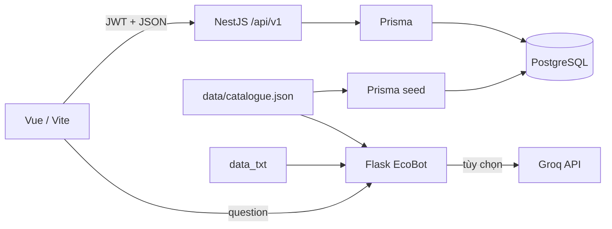

# Kiến trúc và hành vi

## Luồng dữ liệu

Vue dùng service Axios chung để gắn bearer token và timeout. Router guard hỗ trợ điều hướng; quyền truy cập thật được kiểm tra tại backend. Các module NestJS tách controller (HTTP), service (nghiệp vụ), repository (Prisma) và DTO (kiểm tra dữ liệu).

Cấu hình backend đọc qua ConfigModule trước khi tạo JwtModule; cả ký và xác minh token dùng cùng secret. JwtStrategy lấy lại quyền/isActive từ database để token cũ không giữ quyền sau khi tài khoản bị đổi trạng thái.

## Đặt hàng

1. Yêu cầu cần JWT, accountId trùng người đăng nhập, địa chỉ và danh sách items hợp lệ. Số lượng mỗi biến thể từ 1 đến 20; gộp ID trùng trước khi kiểm tra.
2. Trong transaction, backend đọc sản phẩm, phương thức thanh toán và khuyến mãi. Không nhận giá từ client.
3. Trừ kho có điều kiện stock >= quantity. Nếu món cuối đã bị người khác mua, rollback toàn bộ đơn.
4. Chỉ áp dụng khuyến mãi đang bật và trong thời hạn. Phí vận chuyển 30.000đ dưới 500.000đ, miễn phí từ ngưỡng này.
5. Tạo đơn PENDING và lưu đơn giá lúc mua. Hủy đơn dùng cập nhật trạng thái có điều kiện và hoàn kho đúng một lần.
6. Chi tiết đơn chỉ đọc qua đơn có kiểm tra chủ sở hữu. API CRUD chi tiết đơn độc lập cũ đã bỏ vì cho phép sửa giá/số lượng ngoài quy trình checkout.

Luồng trạng thái: PENDING → PAID → SHIPPING → COMPLETED, hoặc PENDING → SHIPPING cho COD; PENDING → CANCELLED. Quản trị không thể mở lại đơn đã hủy/hoàn tất bằng cách đổi trạng thái tùy ý.

## API chính

| Endpoint                                    | Quyền                    | Mục đích                        |
| ------------------------------------------- | ------------------------ | ------------------------------- |
| GET /product, /product/:id                  | Công khai                | Danh sách, tìm kiếm và chi tiết |
| GET /category, /product-variant, /promotion | Công khai                | Dữ liệu cửa hàng                |
| POST /auth/register, /auth/login            | Công khai                | Đăng ký và đăng nhập            |
| GET /cart/user/:accountId                   | Chủ tài khoản            | Xem giỏ                         |
| POST /cart, PUT /cart/:id, DELETE /cart     | Chủ tài khoản            | Chỉnh giỏ                       |
| POST /order                                 | Chủ tài khoản            | Tạo đơn và trừ kho              |
| GET /order/user/:accountId, /order/:id      | Chủ tài khoản            | Lịch sử, chi tiết               |
| DELETE /order/:id                           | Chủ đơn                  | Hủy đơn PENDING và hoàn kho     |
| POST /order/:id/demo-payment                | Chủ đơn, bật demo        | Xác nhận mô phỏng               |
| PUT /order/:id/status                       | ADMIN                    | Chuyển trạng thái               |
| GET /order/stats                            | ADMIN                    | Thống kê                        |
| PATCH /comments/:id/visibility              | ADMIN                    | Ẩn/hiện bình luận               |
| GET /customer_profile/:accountId/profile    | Chủ tài khoản hoặc ADMIN | Hồ sơ                           |
| POST /api/chat (Flask)                      | Công khai                | EcoBot                          |

Xem Swagger để biết thêm endpoint và DTO. Dịch vụ chatbot có /health, nhận question dài tối đa 1000 ký tự, giới hạn body 16KB. Tìm kiếm cục bộ chuẩn hóa dấu tiếng Việt và xếp hạng mức khớp từ khóa. Không có embedding/vector DB; câu hỏi phức tạp hoặc cần dữ liệu đơn cá nhân không được hỗ trợ. Giá trong chatbot là giá danh mục gốc, không cam kết tồn kho hay khuyến mãi trực tiếp.

## Migration

Giữ nguyên migration gốc. Migration 20261110000000_sync_application_schema thêm các cột đã thiếu và chuyển liên kết hồ sơ từ account → profile sang profile → account, backfill liên kết trước khi bỏ cột cũ. Nếu database cũ có hồ sơ không thuộc tài khoản nào, migration dừng và rollback; cần xử lý trên bản sao trước. Bản demo chạy trên database mới, tách khỏi database cũ.
